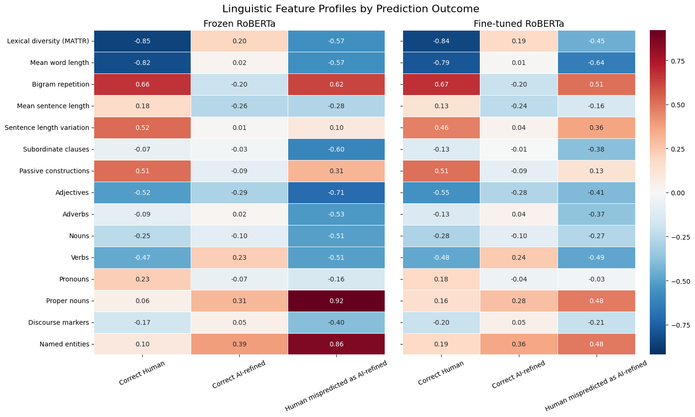

# Quantitative Analysis
we looked at accuracy, precision, recall, and Macro-F1. For each class, we looked at precision, recall, and F1 as well. Lastly, a confusion matrix is included.

* **Accuracy** was selected as a big-picture measure of performance.
* **Macro-F1** was selected as an overview of per-class F1 scores for a balanced look at how the models perform in terms of precision and recall. **F1** was also calculated for each class for a more individual look at what classes the models perform better at.
* **Precision and recall** were selected to get a better idea of what types of error each model tends to produce. These were looked at both on average and for individual classes for a closer look.
* **Confusion matrices** were added to give a visual representation of the types of errors the models tend towards.

#### On Average:

| accuracy | macro-F1 | precision | recall |
| --- | --- | --- | --- |
| 0.9587 | 0.9586 | 0.9600 | 0.9587 |

#### Per-Class:

| | precision | recall | F1-score |
| --- | --- | --- | --- |
|  human | 0.9870 | 0.9120 | 0.9480 |
| ai_generated | 0.9766 | 1.000 | 0.9881 |
| ai_refined | 0.9163 | 0.9640 | 0.9396 |

#### Comparative table: 

| model | accuracy | macro-F1 | precision | recall |
| --- | --- | --- | --- | --- |
| Non-truncated TF-IDF | 0.8657 | 0.8637 | 0.8656 | 0.8657 |
| Truncated TF-IDF | 0.7947 | 0.7961 | 0.8072 | 0.7947 |
| Frozen RoBERTa (256) | 0.8820 | 0.8837 | 0.8937 | 0.8820 |
| Frozen RoBERTa (512) | 0.9153 | 0.9158 | 0.9208   | 0.9153 |
| **Fine-tuned RoBERTa (512)** | **0.9587** | **0.9586** | **0.9600** | **0.9587** |

#### Confusion Matrix:

#### Notes
* Overall, this model outperformed all four of our baseline models by a significant margin. Between the fine-tuned RoBERTa and the previously best model (frozen RoBERTa with 512 limit), accuracy improved by 4.34%, macro-F1 improved by 4.28%, precision improved by 3.92%, and recall improved by 4.34%. This suggests that fine-tuning was an effective way to improve the performance of the model.
* The AI-refined class achieved an F1-score of 0.9396, compared with 0.8837 for frozen RoBERTa (512) (the previous best performance). This is particularly significant because AI-refined text was consistently one of the most difficult classes for the previous models.
* Notably, the fine-tuned model has a recall of 100% for AI-generated samples. Alongside a high precision of 97.66% for the AI-generated class, this is extremely promising performance for detecting AI-generated text, although it also suggests that the model is more prone to overgeneralizing rather than undergeneralizing AI-generated texts.
* There is no longer any confusion between AI-generated and human-written texts (as seen from the confusion matrix, no samples of AI-generated or human-written samples were classed as the other). The only errors now come from classifying AI-refined texts as AI-generated or human-generated, or vice versa. This is significant because it suggests that in a binary classification for AI-generated text, our model will likely perform exceptionally well.
*  However, while human-written precision was very high (98.70%), recall was lower (91.20%). This indicates that when the model predicts a passage is human-written, it is usually correct, but some genuinely human-written passages are still classified as AI-refined. 

# Qualitative Analysis
For qualitative analysis, we were interested in seeing what types of classifications improved through our improvements. Since our fine-tuned model was based on the frozen RoBERTa model with a truncation limit of 512, our comparative analysis is centred on comparing with that model.

In total 130 samples out of the 1500 total text samples (8.7%) were classified differently by the fine-tuned model. Out of those samples, 97 (74.6%) were a shift from incorrect to correct labels. This suggests a larger shift towards correct than incorrect. 

The main shifts were shifts from human to AI-refined (37 samples), and from AI-refined to human (56 samples) or AI-generated (28 samples). This suggests that the most change occured between models in the classification of AI-refined samples. More shifts also occured in the Wiki domain than Academic, likely because.... 

Below we have included some key examples of shifts between the fine-tuned and rozen model.

#### Corrected Predictions

* **From AI-refined to AI-generated (Pair 36852):** The frozen model incorrectly classified an AI-generated passage about the Delahaye 145 racing car as AI-refined, while the fine-tuned model correctly identified it as fully AI-generated. The passage combines factual historical information with polished descriptions such as "rare and sophisticated luxury racing car." This suggests that fine-tuning may help distinguish fully generated encyclopedic writing from AI-refined text, even when both share similar stylistic features.

* **From Human to AI-refined (Pair 109846):** An AI-refined academic passage discussing universalism and Bourdieu was classified as human-written by the frozen model but correctly identified after fine-tuning. The passage contains specialized terminology, citations, and complex arguments typical of human academic writing. This improvement suggests that fine-tuning may help the model recognize AI refinement without relying solely on surface characteristics such as academic vocabulary or formal style.

#### Newly Introduced Errors

* **From Human to AI-refined (Pair 109722):** A human-written academic passage discussing Munch's artwork was correctly classified by the frozen model but incorrectly classified as AI-refined by the fine-tuned model, with a confidence score of 0.99. The text contains direct quotations, citations, and formatting artifacts from document extraction. The high-confidence error raises the possibility that fine-tuning may overemphasize certain academic or structural features associated with AI refinement.

* **From AI-refined to AI-generated (Pair 38782):** An AI-refined passage about Santa Maria Navarrese was correctly classified by the frozen model but incorrectly classified as fully AI-generated after fine-tuning, with a confidence score near 1.00. The passage uses polished descriptive expressions such as "picturesque coastal and tourist town." This suggests that fine-tuning may sometimes associate highly fluent or embellished writing with full AI generation, even when the text originated from human writing that was subsequently refined.

## Linguistic Feature Statistics

#### Characteristics
- We investigated into the major error class in both model (`HMR`, `human-written` mispredicted as `ai-refined`) by illustrating the linguistic feature heatmap comparing to the correctly predicted classes.
- `HMR` is generally more similar to `human` by Lexical Diversity, Mean Word Length, Bigram Repetition, Sentence Length Variation and the distribution of grammatical word types. High occurrence of proper nouns and named entities is observed in the error class compared to either correctly predicted classes.
- Compared with correctly predicted human-written texts, `HMR` samples exhibit shorter sentences, fewer subordinate clauses, and less sentence-length variation in both models.
- HMR does not consistently exhibit linguistic characteristics intermediate between human-written and AI-refined texts. For several features, including proper nouns, named entities, subordinate clauses, and adverbs, HMR exhibits more extreme values than either correctly predicted class. This suggests that classification errors may be associated with atypical human writing characteristics rather than general stylistic similarity to AI-refined content.

#### Difference between Frozen and Fine-tuned Results
Feature	| Frozen HMR − Human | Fine-tuned HMR − Human
| --- | --- | --- |
Proper nouns | +0.86	| +0.32
Named entities | +0.76 | +0.29
Subordinate clauses	| −0.53	| −0.25
Sentence length variation | −0.42 | −0.10
Adverbs	| −0.44	| −0.24
Discourse markers | −0.23 | −0.01
- After fine-tuning, the remaining errors are less distinctive by linguistic features in several domains. It suggests that fine-tuning may improve the classification of entity-rich human-written texts and texts with relatively simple syntactic structures.