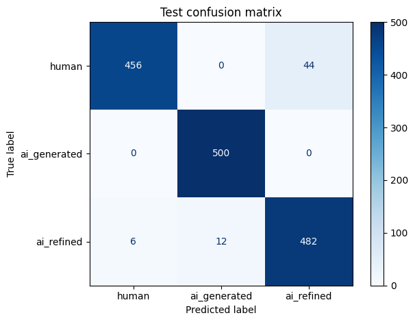

# Quantitative Analysis
we looked at accuracy, precision, recall, and Macro-F1. For each class, we looked at precision, recall, and F1 as well. Lastly, a confusion matrix is included.

* **Accuracy** was selected as a big-picture measure of performance.
* **Macro-F1** was selected as an overview of per-class F1 scores for a balanced look at how the models perform in terms of precision and recall. **F1** was also calculated for each class for a more individual look at what classes the models perform better at.
* **Precision and recall** were selected to get a better idea of what types of error each model tends to produce. These were looked at both on average and for individual classes for a closer look.
* **Confusion matrices** were added to give a visual representation of the types of errors the models tend towards.

#### On Average:

| accuracy | macro-F1 | precision | recall |
| --- | --- | --- | --- |
| 0.9587 | 0.9586 | 0.9600 | 0.9587 |

#### Per-Class:

| | precision | recall | F1-score |
| --- | --- | --- | --- |
|  human | 0.9870 | 0.9120 | 0.9480 |
| ai_generated | 0.9766 | 1.000 | 0.9881 |
| ai_refined | 0.9163 | 0.9640 | 0.9396 |

#### Comparative table: 

| model | accuracy | macro-F1 | precision | recall |
| --- | --- | --- | --- | --- |
| Non-truncated TF-IDF | 0.8657 | 0.8637 | 0.8656 | 0.8657 |
| Truncated TF-IDF | 0.7947 | 0.7961 | 0.8072 | 0.7947 |
| Frozen RoBERTa (256) | 0.8820 | 0.8837 | 0.8937 | 0.8820 |
| Frozen RoBERTa (512) | 0.9153 | 0.9158 | 0.9208   | 0.9153 |
| **Fine-tuned RoBERTa (512)** | **0.9587** | **0.9586** | **0.9600** | **0.9587** |

#### Confusion Matrix:

#### Notes
* Overall, this model outperformed all four of our baseline models by a significant margin. Between the fine-tuned RoBERTa and the previously best model (frozen RoBERTa with 512 truncation limit), accuracy improved by 4.34%, macro-F1 improved by 4.28%, precision improved by 3.92%, and recall improved by 4.34%. This suggests that fine-tuning was an effective way to improve the performance of the model.
* The AI-refined class achieved an F1-score of 0.9396, compared with 0.8837 for frozen RoBERTa (512) (the previous best performance). This is particularly significant because AI-refined text was consistently one of the most difficult classes for the previous models.
* Notably, the fine-tuned model has a recall of 100% for AI-generated samples. Alongside a high precision of 97.66% for the AI-generated class, this is extremely promising performance for detecting AI-generated text, although it also suggests that the model is more prone to overgeneralizing rather than undergeneralizing AI-generated texts.
* There is no longer any confusion between AI-generated and human-written texts (as seen from the confusion matrix, no samples of AI-generated or human-written samples were classed as the other). The only errors now come from classifying AI-refined texts as AI-generated or human-generated, or vice versa. This is significant because it suggests that in a binary classification for AI-generated text, our model will likely perform exceptionally well.
*  However, while human-written precision was very high (98.70%), recall was lower (91.20%). This indicates that when the model predicts a passage is human-written, it is usually correct, but some genuinely human-written passages are still classified as AI-refined. 
* Misclassifications of AI-refined texts as AI-generated increase from 9 to 12. This indicates that fine-tuning may improve the separation between human and AI-assisted writing while sometimes making it more difficult to distinguish refined texts from fully generated texts.

#### Per-domain: 
| Domain | Class | Frozen recall | Fine-tuned recall |
| --- | --- | --- | --- |
| Academic | Human | 96.0% | 93.2% |
| Academic | AI-generated |	100% | 100% |
| Academic | AI-refined	| 91.2%	| 96.4%	|
| Wiki | Human | 72.8% | 89.2% |
| Wiki | AI-generated | 92.0% | 100% |
| Wiki | AI-refined	| 97.2%	| 96.4%	|

#### Notes
- The greatest improvement occurs in human-written Wikipedia articles, where recall increases from 72.8% to 89.2%. In contrast, the performance on human-written academic texts decreases slightly.
- This suggests that fine-tuning is particularly effective at learning features of encyclopedic writing. However, it may introduce a trade-off in identifying human-written academic texts.

#### Prediction Agreement and Statistical Significance:
| | texts |	share |
| --- | --- | --- |
|both correct| 1341	| 0.8940 |
only fine-tuned correct	| 97 | 0.0647
only frozen correct	| 32 | 0.0213
both wrong | 30 | 0.0200
of which wrong in different ways | 1 | 0.0007

Statistical test | Result
| --- | --- |
Exact McNemar test (overall) |	p = 8.499 × 10⁻⁹
McNemar test (Academic)	| p = 0.405
McNemar test (Wiki)	| p = 4.45 × 10⁻¹⁰
Accuracy improvement, 95% bootstrap CI	| [0.0300, 0.0587]
Macro-F1 improvement, 95% bootstrap CI	| [0.0296, 0.0579]

#### Notes
- The models assign different labels to 130 samples, among which the fine-tuned model correctly predicts 97 and the frozen model correctly predicts 32. Only one sample is wrongly assigned by both model.
- The paired bootstrap intervals exclude zero, suggesting that the improvement is unlikely to result only from test-set sampling variability.
- The domain-specific McNemar results also suggest that the improvement is concentrated in Wiki texts rather than Academic texts.

#### Formatting Shortcut and Robustness Test:
Formatting feature	| Human	| AI-generated	| AI-refined
| --- | --- | --- | --- |
Duplicated leading title | 0% | 18.0% | 0%
Contains asterisks	| 1.4%	| 0.2%	| 19.6%
Contains hash symbols | 0%	| 0% | 2.0%
Average word count | 295.5 | 282.3 | 252.9

Metric| Original | Normalized
| --- | --- | --- |
Accuracy | 0.9587 | 0.9573
Macro-F1 | 0.9586 | 0.9572

#### Notes
- We investigated whether the classifier relies on formatting features by applying simple normalization removing certain formats and re-evaluated with the trained model.
- The reported macro-F1 decrease is only approximately 0.0013 using the underlying unrounded scores, suggesting that the improved performance relies little on the formatting.

# Qualitative Analysis
For qualitative analysis, we are interested in comparing examples that were classified incorrectly for our baseline models, which were then fixed in the new model, and examples that were classed correctly for our baseline models but are now classed incorrectly for our fine-tuned model. 

#### Examples that got fixed

#### Examples that got worse

## Linguistic Feature Statistics

#### Characteristics
- We investigated into the major error class in both model (`HMR`, `human-written` mispredicted as `ai-refined`) by illustrating the linguistic feature heatmap comparing to the correctly predicted classes.
- `HMR` is generally more similar to `human` by Lexical Diversity, Mean Word Length, Bigram Repetition, Sentence Length Variation and the distribution of grammatical word types. High occurrence of proper nouns and named entities is observed in the error class compared to either correctly predicted classes.
- Compared with correctly predicted human-written texts, `HMR` samples exhibit shorter sentences, fewer subordinate clauses, and less sentence-length variation in both models.
- HMR does not consistently exhibit linguistic characteristics intermediate between human-written and AI-refined texts. For several features, including proper nouns, named entities, subordinate clauses, and adverbs, HMR exhibits more extreme values than either correctly predicted class. This suggests that classification errors may be associated with atypical human writing characteristics rather than general stylistic similarity to AI-refined content.

#### Difference between Frozen and Fine-tuned Results
Feature	| Frozen HMR − Human | Fine-tuned HMR − Human
| --- | --- | --- |
Proper nouns | +0.86	| +0.32
Named entities | +0.76 | +0.29
Subordinate clauses	| −0.53	| −0.25
Sentence length variation | −0.42 | −0.10
Adverbs	| −0.44	| −0.24
Discourse markers | −0.23 | −0.01
- After fine-tuning, the remaining errors are less distinctive by linguistic features in several domains. It suggests that fine-tuning may improve the classification of entity-rich human-written texts and texts with relatively simple syntactic structures.