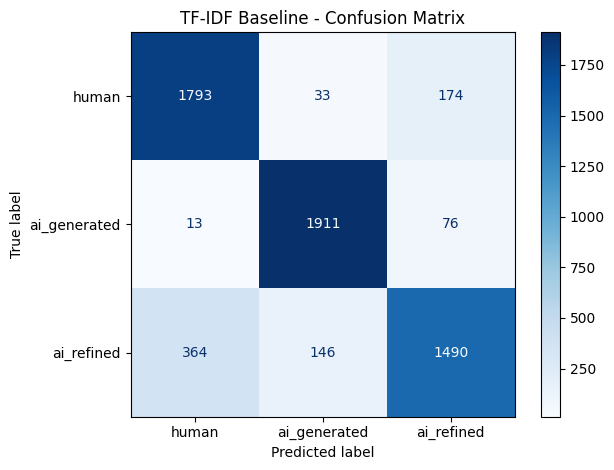
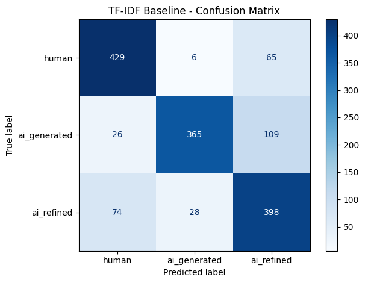
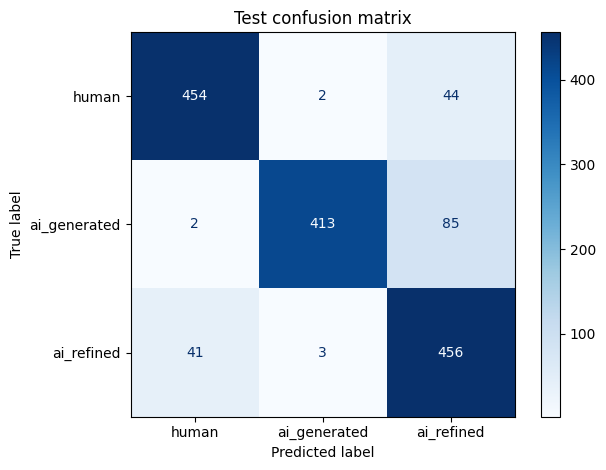
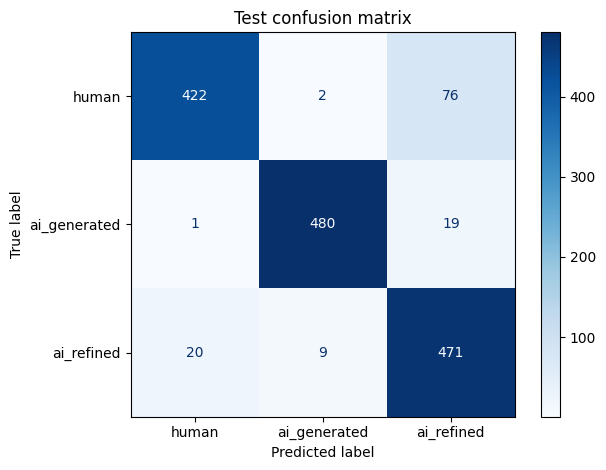

# Quantitative Analysis

For each model, we looked at accuracy, precision, recall, and Macro-F1. For each class, we looked at precision, recall, and F1 as well. Lastly, a confusion matrix is included for each model.

* **Accuracy** was selected as a big-picture measure of performance.
* **Macro-F1** was selected as an overview of per-class F1 scores for a balanced look at how the models perform in terms of precision and recall. **F1** was also calculated for each class for a more individual look at what classes the models perform better at.
* **Precision and recall** were selected to get a better idea of what types of error each model tends to produce. These were looked at both on average and for individual classes for a closer look.
* **Confusion matrices** were added to give a visual representation of the types of errors the models tend towards.

### For the non-truncated TF-IDF Logistic Regression model:

#### On Average:

| accuracy | macro-F1 | precision | recall |
| --- | --- | --- | --- |
| 0.8657 | 0.8637 | 0.8656 | 0.8657 |

#### Per-Class:

| | precision | recall | F1-score |
| --- | --- | --- | --- |
| human | 0.8263 | 0.8965 | 0.8600 |
| ai_generated | 0.9144 | 0.9555 | 0.9345 |
| ai_refined | 0.8563 | 0.7450 | 0.7968  |

#### Confusion Matrix:

#### Notes

* The model achieved an accuracy of 86.57% and a macro-F1 of 0.8637, indicating reasonably strong performance across the three classes.
* It performed best on AI-generated text (F1 = 0.9345), with a recall of 95.55%. This suggests that the model is particularly effective at recognizing fully AI-generated text when it has access to the complete passage.
* The weakest class was AI-refined (F1 = 0.7968), with a recall of only 74.50%. Of the 2,000 AI-refined examples, 364 were classified as human and 146 as AI-generated.
* Very few human or AI-generated examples were confused with one another (33 human -> AI-generated and 13 AI-generated -> human). Most errors involved the AI-refined class. One possible explanation is that TF-IDF relies primarily on lexical information, which may be insufficient to distinguish AI-refined writing from its human-written or fully AI-generated counterparts. The model may recognize vocabulary patterns associated with AI-generated text without capturing the subtler stylistic changes introduced by AI refinement.

### For the truncated TF-IDF Logistic Regression model:

#### On Average:

| accuracy | macro-F1 | precision | recall |
| --- | --- | --- | --- |
| 0.7947 | 0.7961 | 0.8072 | 0.7947 |

#### Per-Class:

| | precision | recall | F1-score |
| --- | --- | --- | --- |
| human | 0.8110 | 0.8580 | 0.8338 |
| ai_generated | 0.9148 | 0.7300 | 0.8120 |
| ai_refined | 0.6958 | 0.7960 | 0.7425 |

#### Confusion Matrix:

#### Notes

* The truncated TF-IDF model achieved an accuracy of 79.47% and a macro-F1 of 0.7961, lower than the non-truncated model's 86.57% accuracy and 0.8637 macro-F1.
* The largest difference to the non-truncated model was in AI-generated recall, which decreased from 95.55% to 73.00%. Of the 500 AI-generated examples, 109 were incorrectly classified as AI-refined.
* Contrastively, AI-refined recall increased from 74.50% to 79.60%, although its precision decreased substantially from 85.63% to 69.58%. This suggests that the model predicts the AI-refined class more broadly, identifying more actual AI-refined examples but also incorrectly assigning more other texts to this class.
* Like the non-truncated model, this one distinguished human-written and AI-generated text relatively well, with only 6 human -> AI-generated and 26 AI-generated -> human errors. 
* The results make sense with regard to the possibility that truncation removes useful lexical information needed to distinguish the classes. Shorter passages may contain fewer distinctive patterns, causing the model to rely on less discriminative features. However, differences between evaluation subsets could also contribute to the performance gap.

### For Frozen RoBERTa with a truncation limit of 256:

#### On Average:

| accuracy | macro-F1 | precision | recall |
| --- | --- | --- | --- |
| 0.8820 | 0.8837 | 0.8937 | 0.8820 |

#### Per-Class:

| | precision | recall | F1-score |
| --- | --- | --- | --- |
| human | 0.9135 | 0.9080 | 0.9107 |
| ai_generated | 0.9880 | 0.8260 | 0.8998 |
| ai_refined | 0.7795 | 0.9120 | 0.8406 |

#### Confusion Matrix:

#### Notes

* The model achieved 88.20% accuracy and a macro-F1 of 0.8837, outperforming both TF-IDF models overall.
* It performed particularly well on human-written text (F1 = 0.9107) and achieved the highest AI-generated precision among the four models (98.80%).
* AI-generated recall was relatively low at 82.60%. Of the 500 AI-generated examples, 85 were incorrectly classified as AI-refined, suggesting that the model was more conservative in predicting fully AI-generated text.
* The model achieved high AI-refined recall (91.20%) but lower precision (77.95%). Many of the examples predicted as AI-refined actually belonged to another class, especially AI-generated text.
* A possible explanation for this improved performance compared with TF-IDF is that RoBERTa's contextual representations may help it distinguish text classes using more than individual word-frequency patterns, even without fine-tuning the underlying encoder.
* The confusion between AI-generated and AI-refined suggests that the representations being frozen makes it so these these categories are not clearly separated in the embeddings. The shorter input limit might be a reason for this.

### For Frozen RoBERTa with a truncation limit of 512:

#### On Average:

| accuracy | macro-F1 | precision | recall |
| --- | --- | --- | --- |
| 0.9153 | 0.9158 | 0.9208   | 0.9153 |

#### Per-Class:

| | precision | recall | F1-score |
| --- | --- | --- | --- |
| human | 0.9526   | 0.8440   | 0.8950 |
| ai_generated | 0.9776   | 0.9600   | 0.9687 |
| ai_refined | 0.8322   | 0.9420 |   0.8837  |

#### Confusion Matrix:

#### Notes

* This model achieved the highest overall performance, with 91.53% accuracy and a macro-F1 of 0.9158.
* It performed especially well on AI-generated text (F1 = 0.9687), correctly identifying 480 of the 500 examples. Its recall of 96.00% was substantially higher than the 256-token model's 82.60%.
* It also improved performance on the AI-refined category, which has proven to be the most difficult, achieving an F1 of 0.8837 compared with 0.8406 for the 256-token model. Only 20 AI-refined examples were mistaken for human text, compared with 41 in the shorter-input model.
* Recall for the human-written class decreased to 84.40%. In particular, the number of human texts misclassified as AI-refined increased from 44 to 76.
* This suggests that longer input limit may help the model recognize patterns associated with AI-generated and AI-refined writing, while also making it more likely to interpret some human-written passages as AI-refined.
* Overall, the results suggest that access to longer passages may benefit contextual classification, particularly when distinguishing fully AI-generated text from AI-refined text. This would be stronger if both RoBERTa variants were confirmed to have been evaluated on exactly the same examples.

### Comparative Notes

#### Table: 

| | accuracy | macro-F1 | precision | recall |
| --- | --- | --- | --- | --- |
| Non-truncated TF-IDF | 0.8657 | 0.8637 | 0.8656 | 0.8657 |
| Truncated TF-IDF | 0.7947 | 0.7961 | 0.8072 | 0.7947 |
| Frozen RoBERTa (256) | 0.8820 | 0.8837 | 0.8937 | 0.8820 |
| Frozen RoBERTa (512) | 0.9153 | 0.9158 | 0.9208   | 0.9153 |

#### In summary:

* Frozen RoBERTa with a 512-token limit achieved the highest accuracy and macro-F1, while truncated TF-IDF performed the worst.
* The 512-token RoBERTa model exceeded the non-truncated TF-IDF model by 4.96 percentage points in accuracy and approximately 0.052 in macro-F1.
* These results are consistent with contextual embeddings offering an advantage over word-frequency features, although differences in test-set size and composition make direct comparisons more tenuous.

#### Across classes:

* All four models found AI-refined text most difficult in contrast to AI-generated, especially for TF-IDF. A possible explanation for this is that AI-refined text shares characteristics with both human-written and fully AI-generated text, potentially making its classification less straightforward. 
* Despite the above, the truncated TF-IDF and 256-token RoBERTa models had lower AI-generated recall, suggesting that token numbers play a role in performance.
* The two RoBERTa models showed substantially better AI-refined recall than non-truncated TF-IDF, suggesting that contextual information may be useful for recognizing AI modification.
* However, improved AI-refined recall sometimes came at the expense of precision, indicating that models may overpredict this intermediate class.

#### Common errors:

* Across all four models, direct confusion between human and AI-generated classes was relatively uncommon. Most misclassifications involved the AI-refined class.
* This suggests that identifying AI involvement in a text may be easier than distinguishing whether the text was fully generated by AI or modified through AI assistance.

### Extra Findings:

* When testing frozen RoBERTa-base with 512-token truncated data, we at first confused `MAX_LENGTH` in tokenizer for 256 instead of 512. The general accuracy of the correct implementation decreased by 1.2% compared to the `MAX_LENGTH=256` version, while `wiki` dropped from 91.2% to 87.33%, and `academic` slightly rose from 94.27% to 95.73%. As increasing the maximum sequence length changes the representation the LR classifier receives, more text can introduce useful information, but it can also introduce noise or weaken the influence of the most informative parts.